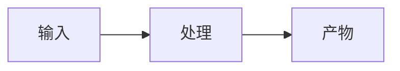

# <文档标题>

> 状态：draft v0.1.0 ｜ 日期：YYYY-MM-DD ｜ 维护者：<agent/用户>

## Terminology

| 术语 | 定义 |
|---|---|
| <正文关键词> | <一句话定义；与全仓库正本一致> |

## 1. 背景与目标

<要解决的问题；本文档回答的唯一核心问题（一句话，加粗或引用块）。>

## 2. 范围

### In scope

1. <条目>

### Out of scope

- <明确排除项 + 原因>

## 3. <正文章节（设计/规则/协议）>

<表格优先；流程/状态用 mermaid；同一规则只写一处正本，他处链接。>

## 4. 验收标准

- [ ] <可核对的条目>

## 5. 开放问题

| # | 问题 | 影响 | 决议 |
|---|---|---|---|
| Q1 | | | |

## 附录：引用

- <文件路径 / 消息 id / commit hash>

<!--
写作检查清单（提交前删除本注释）：
1. 元信息行齐全（状态/版本 a.b.c/日期/维护者）
2. 章节编号连续，层级 ≤4
3. ≥3 项对比已表格化；图为 mermaid
4. 中英文之间空格；文件名/命令/hash 用反引号
5. Terminology 覆盖正文关键词，定义与全仓库正本一致
6. 篇幅 >300 行考虑拆分
-->
