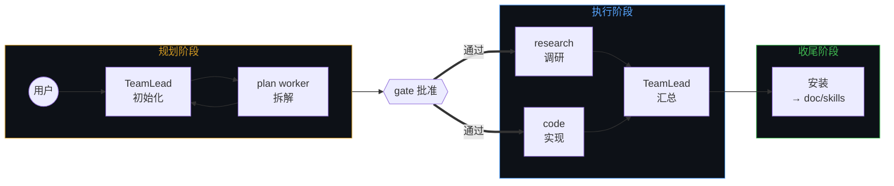
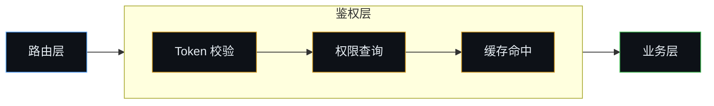
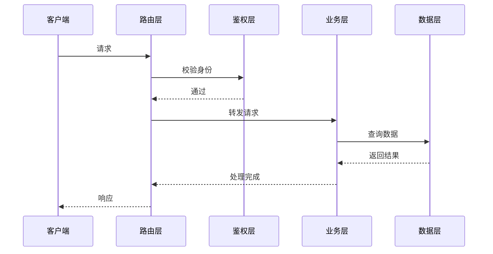

# doc-viz — 全局可视化规范

> 状态：active v2.0.0 ｜ 日期：2026-10-18 ｜ 维护者：Kilo（用户指令）

**原则：信息形态决定表达形式。** 能画图不列表，能列表不散文。

## Terminology

| 术语 | 定义 |
|---|---|
| 信息形态 | 时序 / 状态 / 结构 / 清单——选图型前先判形态 |
| 渲染页 | view.html / HTML 文档页——零外部依赖，自绘 |
| 泳道图 | 按角色分泳道展开事件——不用盒子 pipeline |

## 1. 原则

1. Markdown优先mermaid, HTML优先mermaid/html图示, 或者可交互HTML示例
2. 每个图应当保持单一视角/主题，避免混合多种信息形态
3. 图示内容太多(>10个单位)时，应当考虑按层级、分组、分页、折叠等方式拆分，拆分通常不超过3个层级。
4. 使用颜色和注脚
   - 颜色：用于区分不同类型的节点或状态，增强可读性。
   - 注脚：用于解释图中符号、缩写或特殊标记，确保图示易于理解。

## 2. 图示参考

### 流程回路

> 注脚：三个 `subgraph` 分阶段——橙色=规划，蓝色=执行，绿色=收尾。gate 从子图内提到子图间作为阶段衔接点。

### 分层调用

> 注脚：蓝色=入口，橙色=中间层，绿色=核心。分层从左往右递进。

#### 子图展开

> 注脚：第二张用 `subgraph` 展开鉴权层内部——Token 校验 → 权限查询 → 缓存命中。子图内遵循同样的横向分层节奏，颜色与第一张一致。

### 调用时序

> 注脚：`->>` 实线调用，`-->>` 虚线返回。自上而下是时间轴，每列一个角色，交互清晰。