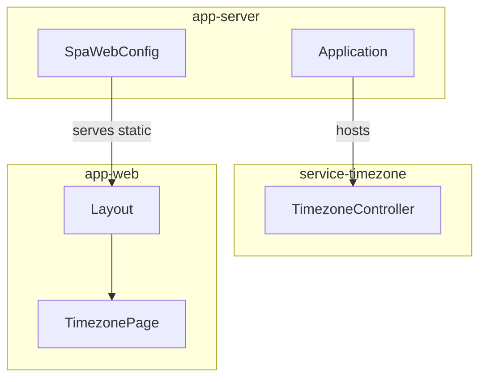
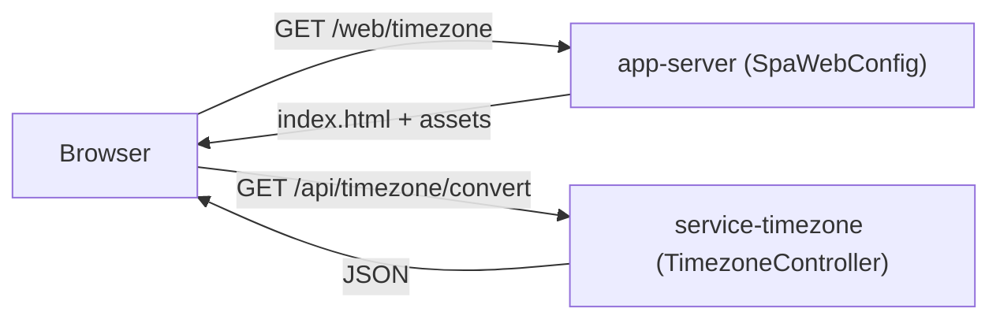
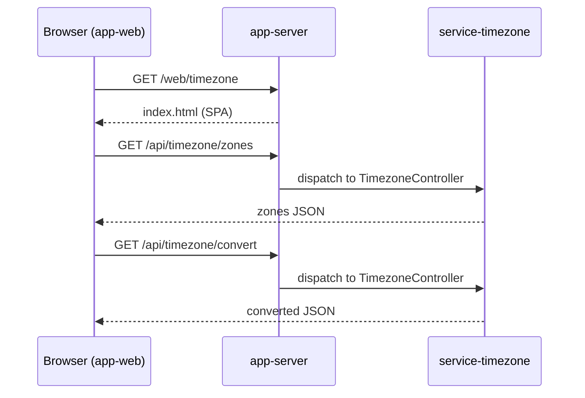
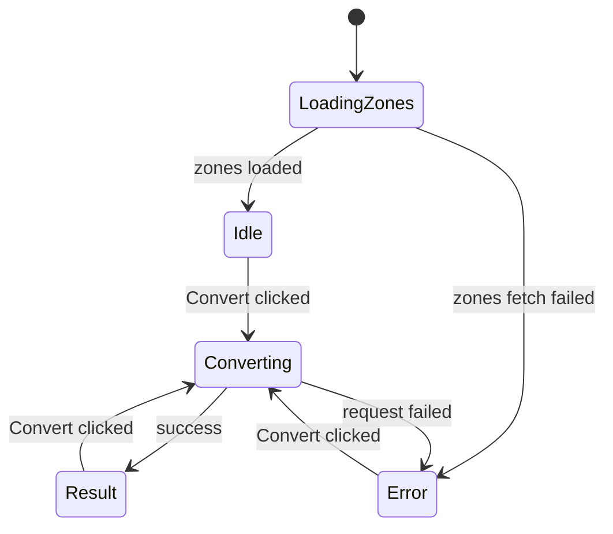

# Doc diagram
> Version: 1.0.0
> Updated: 2026-09-19

# Purpose
> Standard diagrams for project docs, to make component/project review easier and consistent.
> Applies to: any doc describing components, architecture, flows, or states.

# Rule: Format
> Mermaid only, in fenced ```mermaid blocks - renders in VS Code preview/GitHub, source stays reviewable
> One topic per diagram; keep node count lean (<= ~12 nodes)
> Label with real module/component names (e.g. `app-server`, `service-timezone`, `app-web`); keep labels short
> Diagrams version with their doc - bump the doc version on any diagram change

# Standard diagram set

## Component / module structure
> Shows modules/components and how they contain or depend on each other.
> Use when: project/module overview, architecture sections, hosting/dependency rules.



## Data / request flow
> Shows how a request/data moves between components end to end.
> Use when: explaining behavior, API usage, integration points.



## Sequence
> Shows ordered interactions between participants over time.
> Use when: APIs, use cases, multi-step flows where order matters.



## State
> Shows lifecycle states and transitions of one component/entity.
> Use when: stateful UI, entity lifecycles, protocol/job states.



# Changelog
| Version | Date | Change |
|---|---|---|
| 1.0.0 | 2026-09-19 | Initial: Mermaid format rule + standard set (component, data flow, sequence, state) |
