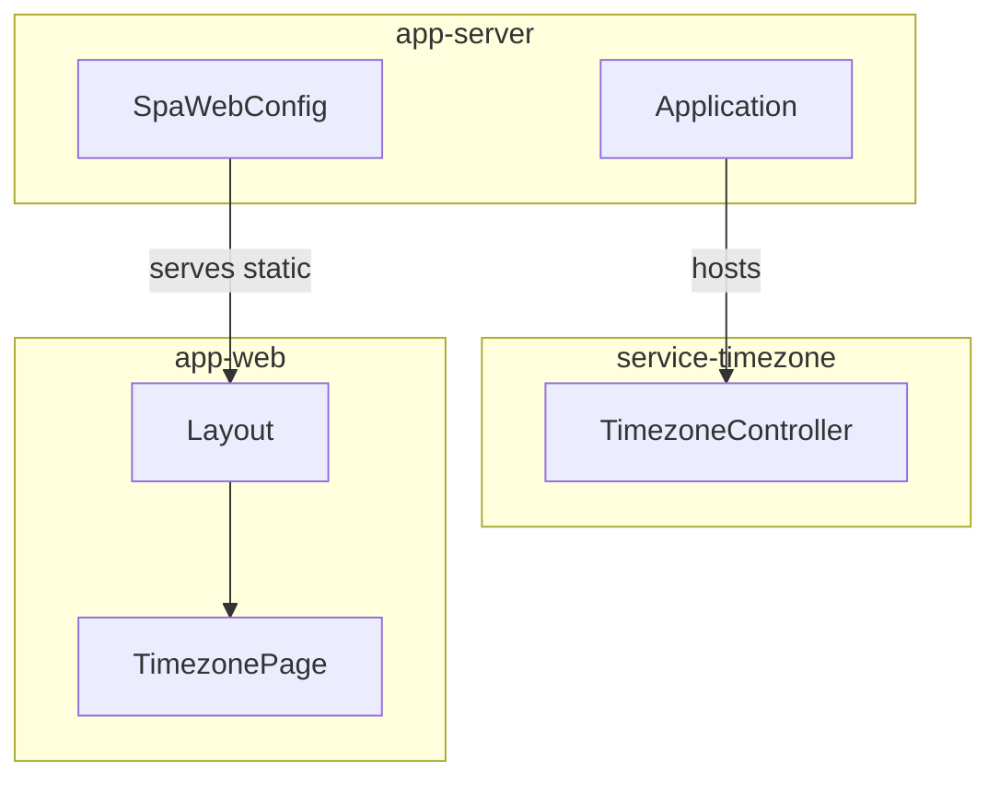
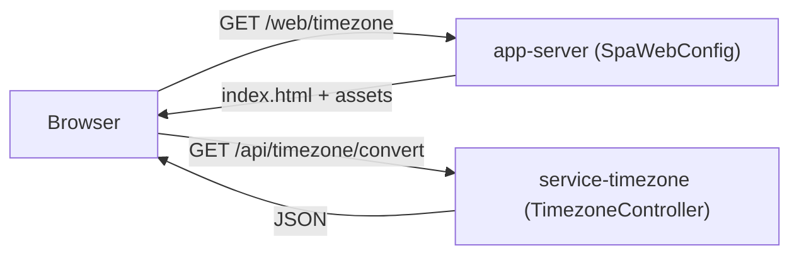
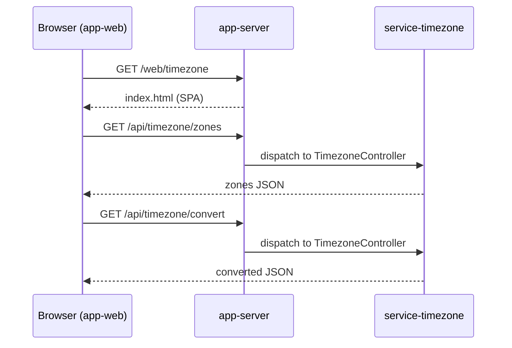
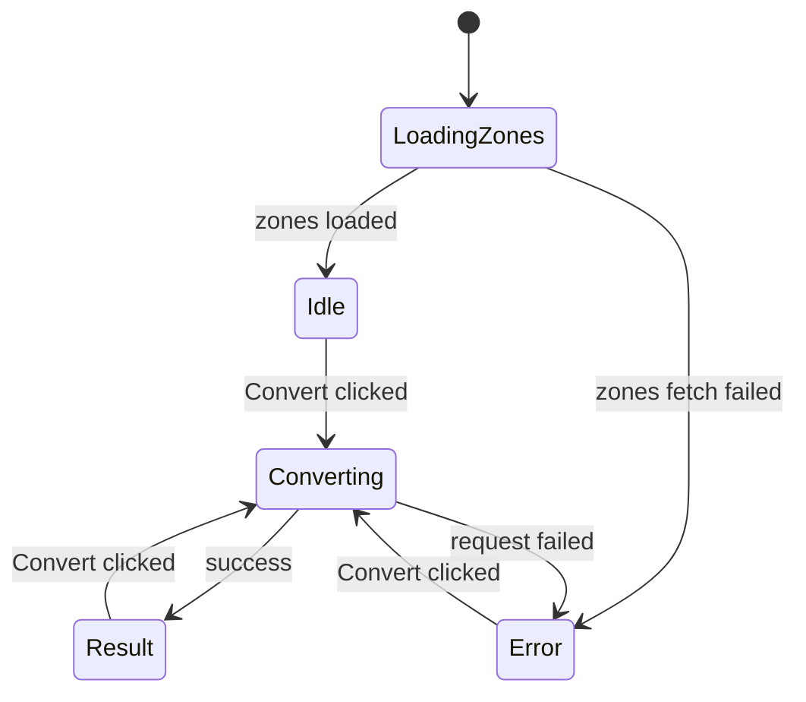
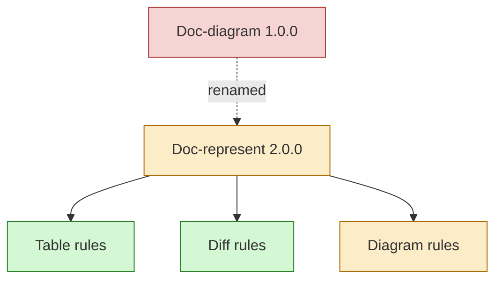

# Doc represent
> Version: 2.0.0
> Updated: 2026-09-19

# Purpose
> Standard representation for project docs - diagrams and tables - to make component/project review easier and consistent.
> Applies to: any doc describing components, architecture, flows, states, or tracking/comparison of items.

# Rule: Format
> Mermaid only, in fenced ```mermaid blocks - renders in VS Code preview/GitHub, source stays reviewable
> One topic per diagram; keep node count lean (<= ~12 nodes)
> Label with real module/component names (e.g. `app-server`, `service-timezone`, `app-web`); keep labels short
> Diagrams version with their doc - bump the doc version on any diagram change

# Standard diagram set

## Component / module structure
> Shows modules/components and how they contain or depend on each other.
> Use when: project/module overview, architecture sections, hosting/dependency rules.



## Data / request flow
> Shows how a request/data moves between components end to end.
> Use when: explaining behavior, API usage, integration points.



## Sequence
> Shows ordered interactions between participants over time.
> Use when: APIs, use cases, multi-step flows where order matters.



## State
> Shows lifecycle states and transitions of one component/entity.
> Use when: stateful UI, entity lifecycles, protocol/job states.



# Rule: Representation choice
> Diagram: structure, flow, or state - relationships, order, lifecycles
> Table: tracking, comparison, or status of parallel items - rows of the same shape
> List: short unordered or sequential points
> Items share fields and carry per-item state -> table; relationships matter -> diagram

# Rule: Table format
> Markdown tables only, header row required
> One topic per table; lean cells - short phrases, no paragraphs
> Rows keyed by real item names (docs, modules, tasks)

# Standard table set

## Progress tracking
> Tracks progress of items in a doc or change artifact.
> Use when: task progress, rollout status, multi-item migrations.

| Item | Status | Notes |
|---|---|---|
| Rule doc rename | done | Doc-diagram -> Doc-represent |
| Config wiring | pending | openspec/config.yaml |

## Index
> Maps docs to version and topic; canonical example: the rules table in `doc/AGENTS.md`.

| Doc | Version | Topic |
|---|---|---|
| Doc-represent | 2.0.0 | representation standards for docs |

## Changelog
> One lean row per version at the end of every doc.

| Version | Date | Change |
|---|---|---|
| 2.0.0 | 2026-09-19 | Renamed to Doc-represent; added table + diff rules |

# Rule: Change/diff representation
> Present changes as diffs, not prose descriptions
> Text/code change: unified diff in a fenced ```diff block
> Diagram change: one Mermaid diagram with classDef highlight (added/removed/changed); use a before/after pair when the change is large

## Text diff example

```diff
- | [Doc-diagram](./rules/Doc-diagram.md) | 1.0.0 | diagram standards for docs |
+ | [Doc-represent](./rules/Doc-represent.md) | 2.0.0 | representation standards for docs |
```

## Diagram diff example
> Green = added, red = removed, orange = changed.



# Changelog
| Version | Date | Change |
|---|---|---|
| 1.0.0 | 2026-09-19 | Initial: Mermaid format rule + standard set (component, data flow, sequence, state) |
| 2.0.0 | 2026-09-19 | Renamed Doc-diagram -> Doc-represent; added representation choice, table format + standard set, change/diff representation |
