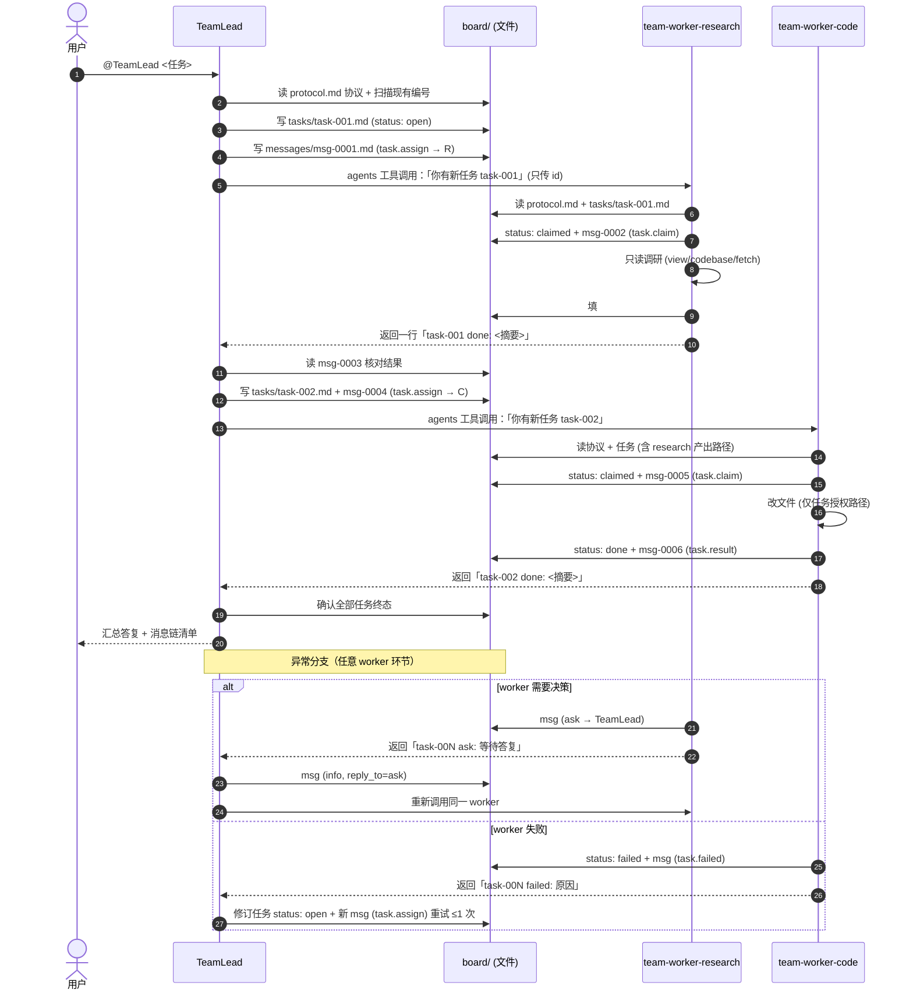
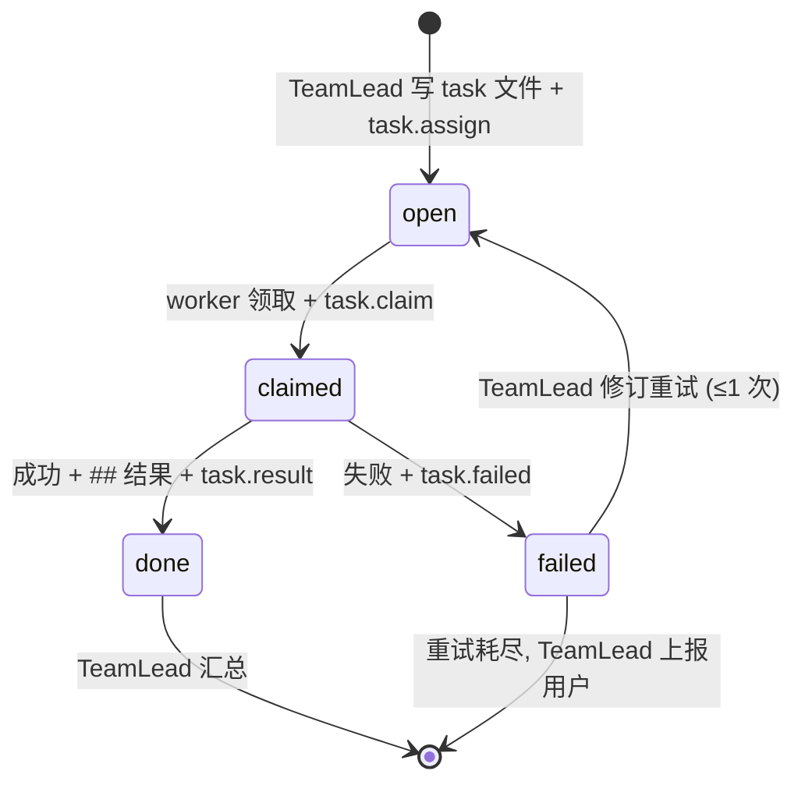
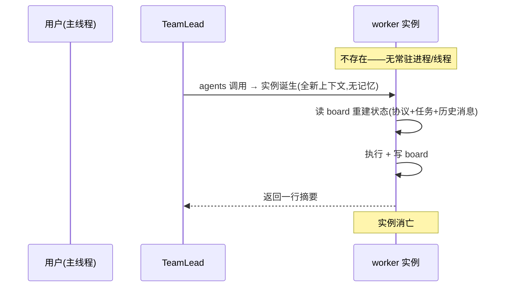

# team-core 设计：主从 Agent Team 编排架构

> 状态：active v0.3.0 ｜ 日期：2026-10-16 ｜ 维护者：Kilo（用户指令）

## Terminology

| 术语 | 定义 |
|---|---|
| spec | 一次大任务及其运行工作目录 `doc/specs/<spec>/` |
| board | spec 下 tasks/messages/state.json，编排唯一事实源 |
| TeamLead / worker | 主 agent / 执行 agent；线程模型见 §1.3 |
| 命名空间编号 | 并行消息编号 `msg-<taskid>-NN`（§8） |
| 状态盘 | state.json + view.html 组合（§7） |

## 1. 架构总览

```
用户 ──@TeamLead──▶ VSCode Chat (agent mode)
                        │
                        ▼
                 team-lead.agent
                   │  1. 拆任务 → board/tasks/task-NNN.md (status: open)
                   │  2. 写分派消息 → board/messages/msg-NNNN.md (task.assign)
                   │  3. agents 工具调用 worker，只传 task id
                   ▼
        team-worker-research / team-worker-code
                   │  4. 读 doc/skills/team-core/protocol.md + 任务文件
                   │  5. status: claimed → 干活 → 写 task.result 消息
                   │  6. status: done / failed，返回一行摘要给 TeamLead
                   ▼
                 team-lead
                      7. 读结果消息，全部 done 后汇总答复用户
```

- 全部为 Copilot custom agent（`.github/agents/*.agent.md`），无脚本、无扩展代码。
- 串行执行：TeamLead 一次调用一个 worker，等其返回后再继续。
- board 是唯一事实源：TeamLead 调 worker 时只传任务 id，任务内容与结果都走文件。

### 1.1 端到端调用时序图



### 1.2 任务状态机



### 1.3 会话线程模型（worker 不自转）



- **驱动方向单一**：只有 TeamLead 调用能让 worker 存在；board 上 `open` 任务无人轮询。
- **worker 无状态**：跨调用的"对话线程"不在内存，而是 board 消息文件重建的逻辑线程（task id + reply_to 链）。`ask` 流程即：worker 发 ask 后消亡 → TeamLead 写 info 回帖 → TeamLead 重新调用**全新** worker 实例 → 该实例从 board 读到问答上下文再继续。
- **串行（默认）**：串行模式下 TeamLead 一次只嵌套一个 worker 子请求；并行模式（worktree 分割 + 批量发起）见 §8。
- **固有限制**：worker 自转监听任务队列需要脚本/常驻进程，超出「纯 .md」范围（Out of scope）。

## 2. 目录布局（skills = 规范，specs = 运行）

```
techs/                                # VS Code 工作区根
├── .github/agents/                   # agent 定义（仓库根直接被发现）
│   ├── team-lead.agent.md
│   ├── team-worker-research.agent.md
│   └── team-worker-code.agent.md
├── doc/rule/doc-rule/                # 文档规范（全局覆盖：结构/Terminology/版本管理 + chat 展示 + template/）
├── doc/skills/                       # team 规范（运行时所有 agent 只读）
│   ├── AGENTS.md                     # 目录规则（顶层唯一文件）
│   ├── team-core/                    # skill：team 主运行框架
│   │   ├── SKILL.md                  # 框架入口：概览 / 运行 / 重置
│   │   ├── protocol.md               # 协议正本（spec/task/message/状态机/铁律/并行增量）
│   │   ├── design.md                 # 本文件：架构与设计依据
│   │   ├── NOTES.md                  # 运行观测记录
│   │   └── template/                 # task / message / state-template / lead-subagent-io / lead-spec-context / worker-reply
│   ├── team-board/                   # skill：过程可视化（view.html 状态盘渲染）
│   │   ├── SKILL.md
│   │   └── template/                 # view.html
│   └── team-parallel/                # skill：worktree 并行编排（TeamLead 执行，§8）
│       └── SKILL.md
└── doc/specs/<spec>/              # 每个spec的运行工作目录（TeamLead 初始化）
    ├── board/
    │   ├── tasks/task-NNN.md         # 每任务一文件
    │   ├── messages/msg-NNNN.md      # 每消息一文件，NNNN 递增（扫描现有最大值 +1）
    │   ├── state.json                # 状态汇总视图（TeamLead 单点维护，§7）
    │   └── view.html                 # 初始化时从 team-board/template 复制（§7）
    └── （任务产物文件）
```

## 3. 任务文件 schema（board/tasks/task-NNN.md）

> §3–§5 为设计期摘要；schema 与状态机正本见同目录 `protocol.md`。

```yaml
---
id: task-001
title: <一句话标题>
status: open            # open → claimed → done | failed
assignee: team-worker-research | team-worker-code
created_by: TeamLead
ts: <ISO8601>
---
```

正文段落：`## 任务描述`、`## 验收标准`、`## 结果`（worker 完成时填写摘要）。

## 4. 消息文件 schema（board/messages/msg-NNNN.md）

```yaml
---
id: msg-0001
type: task.assign | task.claim | task.result | task.failed | ask | info
from: TeamLead | team-worker-research | team-worker-code
to: <agent name>
task: task-001          # 关联任务，无任务时为 null
reply_to: msg-0000      # 可选
ts: <ISO8601>
---
```

正文为自由 markdown。消息文件一旦写入不得修改或删除（append-only，纠错发新消息 reply_to 指向原消息）。

## 5. 状态机与流转规则

| 事件 | 动作方 | 状态变化 | 必写消息 |
|---|---|---|---|
| 创建任务 | TeamLead | → open | task.assign（to=worker） |
| 领取任务 | worker | open → claimed | task.claim |
| 完成 | worker | claimed → done，填 `## 结果` | task.result（含摘要 + 产物路径） |
| 失败 | worker | claimed → failed | task.failed（含原因） |
| worker 提问 | worker | 不变 | ask（to=TeamLead），并在返回摘要中说明 |
| 汇总 | TeamLead | 检查全部 done | info（可选）+ chat 答复用户 |

失败处理：TeamLead 收到 task.failed 后可改写任务重试（最多 1 次）或终止并向用户说明。

## 6. agent 职责边界

| agent | tools | 可写范围 |
|---|---|---|
| TeamLead | view, editFiles, agents, codebase | spec 的 `board/**`、不直接改业务文件 |
| team-worker-research | view, codebase, fetch, editFiles | spec 的 `board/**`、任务指定的输出文件（默认只读调研） |
| team-worker-code | view, editFiles, runCommands, codebase | spec 的 `board/**`、任务授权白名单路径 |

所有 agent 对 `doc/skills/**` 只读。写范围只由 prompt 约定（无代码强制）——违反情况记入同目录 `NOTES.md` 观测。

## 7. 状态可视化（state.json + view.html）

- **`<spec>/board/state.json`**：单文件状态汇总——总 flow（goal/phase/steps）、各 task 状态、各 agent 状态（idle/working/waiting/failed）、消息索引。**TeamLead 是唯一写者**，每次状态流转后立即写盘；worker 与渲染页只读（铁律 3 的收窄）。
- **一致性规则**：state.json 只是汇总视图，任务/消息文件仍是事实源；冲突时以文件为准，TeamLead 修正 state.json。
- **`view.html`**：模板在 `doc/skills/team-board/template/view.html`，TeamLead 初始化 spec 时复制到 `<spec>/board/view.html`。零依赖只读状态盘，NavTab 多标签——首页为总视图（每 2s `fetch('state.json')` 渲染 flow 管线、agent 状态灯、task 表、消息链），点击 task/消息 id 新开标签渲染对应 .md（内置迷你 markdown 渲染器，frontmatter 渲染为字段表；标签激活时重新拉取）。file:// 下 fetch 被 CORS 拦截，须经 http 打开：

  ```powershell
  npx -y http-server doc\specs\<spec>\board -p 8787 -c-1   # → http://127.0.0.1:8787/view.html
  ```

- **数据契约与维护职责正本**：同目录 `protocol.md`「state.json（数据契约与维护职责）」节；渲染行为与启动方式见 `doc/skills/team-board/SKILL.md`。

## 8. 并行模式（team-parallel skill）

串行为默认。当子任务 ≥2 且授权路径互不相交（或用户明确要求并行）时，TeamLead 执行 `doc/skills/team-parallel/SKILL.md`：

- **隔离**：每任务一个 git worktree + 分支（仓库内 `.worktrees/<spec>/task-NNN`，`.gitignore` 排除），业务文件互不可见；board 不进 worktree，所有 agent 以绝对路径共享主工作副本的 board
- **防撞号**：并行任务消息用 `msg-<taskid>-NN` 命名空间，TeamLead 全局消息仍 `msg-NNNN`
- **汇合**：worker 在自己分支 commit 并报 hash；TeamLead 核验后串行 `git merge --no-ff`、清理 worktree/branch；冲突 abort + 上报用户
- **通道无关**：只依赖 git CLI；调用通道可为 Copilot `agents`（同步→退化串行）/ Kilo `task`（background→真并行）/ 人肉多窗口；隔离性与正确性不随通道变化
- 协议增量正本：`protocol.md`「并行模式」节
