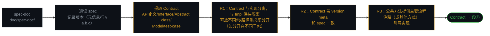
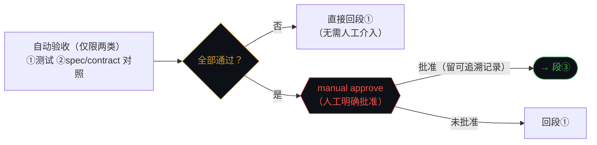
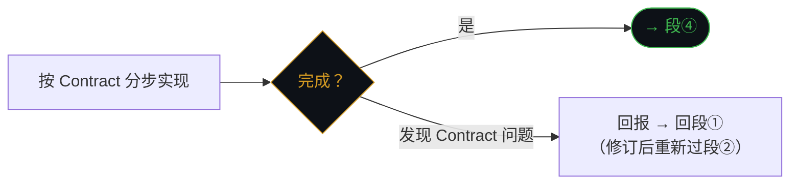
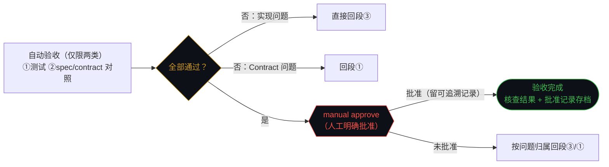

# SDD spec 分步实现指南（impl-guide）

> 状态：draft v0.10.0 ｜ 日期：2026-10-18 ｜ 维护者：TeamLead（用户指令）

本指南定义给定一份 SDD spec（spec-driven-dev 产出的五 tab 单文件 HTML 文档）的分步实现工作流：**Contract 先行**，起点是 **spec-doc**，主干为**四段**。核心要求：**按当前的 spec 实现 Contract**（硬约束 R1/R2/R3 见 sub-steps flow ① Contract imple 段）。

> 沿革：v0.2.0 起以 Contract 替代「契约」（用户指令）；v0.3.0 起起点显式为 spec-doc；v0.5.0 清除自行发明内容；v0.6.0 「分段 flow 图」更名 **sub-steps flow**（markdown 无原生 tabs，沿用 `
` 展开收起——用户确认）；v0.7.0 按用户指令合并原段①/②为 **Contract imple**（四段主干），移除面板内全部规则细节——只要求按当前的 spec 实现 Contract；v0.8.0 加入用户补充要求 3 条（Contract version meta 与 spec 一致 / 与 Impl 保持隔离如分子包 / 公共方法提供主要流程注释）；v0.9.0 移除顶部 R1/R2/R3 与用户补充两段原话块——要求内容完整收入 sub-steps flow「① Contract imple」段 flow 图节点（D/E/F）；v0.10.0 按用户指令移除「验收清单（逐项核对）」整节。

## Terminology

| 术语 | 定义 |
|---|---|
| SDD spec | spec-driven-dev 产出给定 scope 的五 tab 单文件可视化文档（概要/需求/对外接口 · 契约/测试/实现设计 · 架构） |
| spec-doc | `doc/spec-doc/` 下作为项目当前文档 source-of-truth 的 SDD spec——**本工作流的起点**；`doc/spec-changes/` 内进行中的 change 草稿不得作为起点 |
| Contract | 用户定义原话：**API定义 / Interface / Abstract class / Model / test-case 这类切面契约**；全文以 Contract 替代「契约」 |
| 四段 | Contract imple（起点 spec-doc）→ Contract review → Full impl → Final review（用户指定主干；v0.7.0 由原五段合并 ①/② 而来） |
| 自动验收 | review 段中可自动执行的部分，**仅限两类：测试 或 spec/contract 对照**（用户原话）；两类之外不得自动验收 |
| manual approve | review 段的通过方式：**人工（用户/授权人）明确批准**；review 默认 manual approve（用户指令），含糊答复视为未批准 |
| 版本锚定 | R2 机制：Contract 带 **version meta** 并与 spec 一致；spec 版本的唯一落点为其元信息行 `v a.b.c`（doc-format 规范） |

## 工作流总览

**主步骤图**（段级视角；每段内部流程见下方 **sub-steps flow**，逐段展开）：

```mermaid
flowchart LR
    SD(["spec-doc<br/>doc/spec-doc/（source-of-truth）"]) --> S1["① Contract imple<br/>按当前 spec 产出 Contract"]
    S1 --> S2["② Contract review<br/>（自动验收）"]
    S2 --> GA{{"manual approve<br/>（人工）"}}
    GA --> S3["③ Full impl<br/>按 Contract 分步实现"]
    S3 --> S4["④ Final review<br/>（自动验收）"]
    S4 --> GB{{"manual approve<br/>（人工）"}}
    GB --> DN(["验收完成<br/>核查结果 + 批准记录存档"])
    GA -. "未批准：回 ①" .-> S1
    GB -. "未批准：按问题归属回 ③/①" .-> S3

    classDef spec fill:#0d1117,stroke:#8b949e,color:#8b949e
    classDef cimp fill:#0d1117,stroke:#d29922,color:#d29922
    classDef rev fill:#0d1117,stroke:#bc8cff,color:#bc8cff
    classDef fimp fill:#0d1117,stroke:#58a6ff,color:#58a6ff
    classDef dn fill:#0d1117,stroke:#3fb950,color:#3fb950
    classDef gate fill:#0d1117,stroke:#f85149,color:#f85149
    class SD spec
    class S1 cimp
    class S2,S4 rev
    class S3 fimp
    class DN dn
    class GA,GB gate
```

> 注脚：灰=起点 spec-doc，橙=①Contract imple，紫=②/④ review（自动验收），蓝=③Full impl，绿=验收完成；红菱形=manual approve（人工明确批准方可进入下一段）。虚线=人工未批准回退；自动验收不通过的回退画在 sub-steps flow 的分段图中。

### sub-steps flow（每段展开：flow 图）

① Contract imple — 按当前 spec 产出 Contract（起点 spec-doc）

> 注脚：灰=spec 起点动作，橙=Contract 产出动作（D/E/F 对应硬约束 R1/R2/R3），绿端点=本段出口。

② Contract review — 实现前评审 = 验收

> 注脚：黄菱形=自动核查判定，红菱形=人工批准。agent 只准备核查结果，不得自行判定通过；无批准记录=本段未通过。

③ Full impl — 按 Contract 分步实现

> 注脚：实现期间不得私改 Contract；Contract 问题一律回报并回段①处理。

④ Final review — 终验 = 验收

> 注脚：与段②同构——自动仅两类，其余归人工；批准记录含批准对象、批准人、时间戳、结论。

