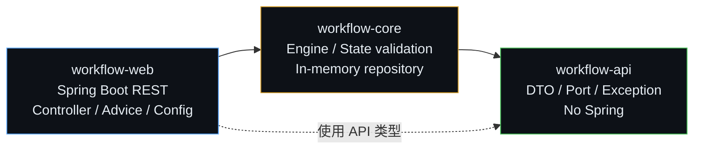
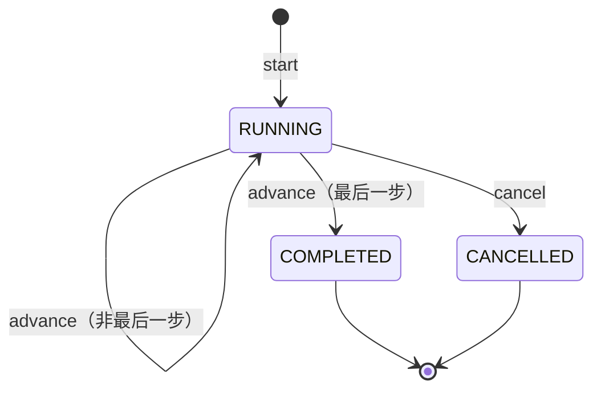
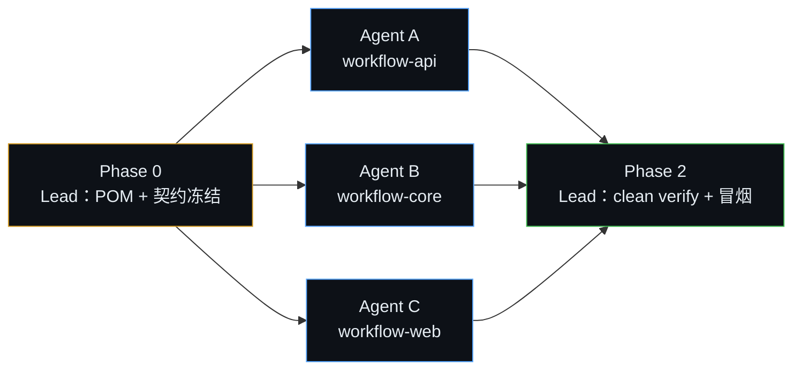

# workflow-web — 三模块 Maven 工程 Spec

> 状态：draft v0.1.0 ｜ 日期：2026-10-22 ｜ 维护者：Kilo（用户指令）

## Terminology

| 术语 | 定义 |
|---|---|
| spec-change | 本次变更的根目录 `doc/spec-changes/workflow-web/` |
| 子项 | 交给单个 subagent 的模块级任务包，共 3 个 |
| 冻结契约 | Phase 0 确定、Phase 1 不允许单方面修改的 API 签名与包名 |
| workflow-api | 纯 Java 契约模块：DTO、端口接口、异常、状态枚举 |
| workflow-core | 领域与执行模块：状态校验、服务实现、内存仓库 |
| workflow-web | Spring Boot 接入模块：REST、异常映射、启动类、配置 |
| Lead | 负责 Phase 0 脚手架、Phase 1 协调与 Phase 2 集成的父代理 |
| 模块自测 | 子代理只对本模块执行 `mvn -pl <module> test`，避免并发全量构建 |

## 1. 目标

在 `project/` 下创建一个可构建、可运行、可测试的三模块 Maven 工程：

- `workflow-api`：对外契约，零 Spring 依赖。
- `workflow-core`：工作流实例的启动、推进、查询、取消；内存仓库；可替换持久化端口。
- `workflow-web`：Spring Boot REST 接入，暴露工作流 HTTP API。

首版只做单机内存实现，不引入数据库、消息队列、鉴权、分布式调度。

## 2. 范围

### In scope

- 父工程与三个模块的 POM、目录、包结构、README、Maven Wrapper。
- `WorkflowService` 端口与 DTO 契约。
- 工作流实例状态机：`RUNNING → COMPLETED / CANCELLED`。
- 内存仓库与线程安全的实例存储。
- 4 个 REST 端点与统一错误响应。
- 模块级单元测试、Web 切片测试、最终集成冒烟。
- 3 个子代理并行交付与 Lead 收口。

### Out of scope

- 数据库、ORM、Flyway、事务。
- 认证/授权、多租户、限流。
- 工作流定义管理 UI、BPMN、定时器、补偿、重试、分布式执行。
- 消息队列、事件总线、外部系统连接器。
- 生产级可观测性栈（仅保留 actuator health/info）。

## 3. 架构与依赖



> 注脚：实线 = 编译依赖；`workflow-web` 通过 `workflow-core` 传递依赖 `workflow-api`，虚线表示它直接使用 API 类型（端口、DTO）。禁止反向依赖与循环依赖。

## 4. 模块划分

| 子项 | 路径 | 产物 | 依赖 | 任务书 |
|---|---|---|---|---|
| Agent A · workflow-api | `project/workflow-api/` | `workflow-api-0.1.0-SNAPSHOT.jar` | 无 | [workflow-api/task-requirement.md](workflow-api/task-requirement.md) |
| Agent B · workflow-core | `project/workflow-core/` | `workflow-core-0.1.0-SNAPSHOT.jar` | workflow-api、spring-context | [workflow-core/task-requirement.md](workflow-core/task-requirement.md) |
| Agent C · workflow-web | `project/workflow-web/` | 可执行 `workflow-web-0.1.0-SNAPSHOT.jar` | workflow-core、starter-web、starter-validation、starter-actuator | [workflow-web/task-requirement.md](workflow-web/task-requirement.md) |

## 5. 对外契约

### 5.1 端口

包名：`com.example.workflow.api`

```java
public interface WorkflowService {
    WorkflowInstance start(StartWorkflowCommand command);
    WorkflowInstance advance(String instanceId);
    WorkflowInstance get(String instanceId);
    WorkflowInstance cancel(String instanceId);
}
```

### 5.2 模型

```java
public record StartWorkflowCommand(
    String workflowType,
    List<String> steps,
    Map<String, Object> variables
) {}

public record WorkflowInstance(
    String id,
    String workflowType,
    List<String> steps,
    int currentStep,
    WorkflowStatus status,
    Map<String, Object> variables,
    Instant createdAt,
    Instant updatedAt
) {}

public enum WorkflowStatus {
    RUNNING,
    COMPLETED,
    CANCELLED
}
```

约束：

- `currentStep` 为 0-based 下标；`steps` 非空且元素非空白。
- `steps` 与 `variables` 必须防御性复制；对外不可变。
- `id` 由 core 生成 UUID 字符串。
- `start` 成功后 `status=RUNNING`、`currentStep=0`。
- `advance`：非最后一步则 `currentStep+1`；最后一步则 `status=COMPLETED`，`currentStep` 保持最后一步。
- `cancel`：`RUNNING → CANCELLED`；对 `CANCELLED` 幂等返回当前实例；对 `COMPLETED` 抛 `WorkflowStateException`。

### 5.3 异常

```java
public class WorkflowException extends RuntimeException {}
public class WorkflowValidationException extends WorkflowException {}
public class WorkflowNotFoundException extends WorkflowException {}
public class WorkflowStateException extends WorkflowException {}
```

### 5.4 REST 端点

| Method | Path | Body | 成功 | 主要错误 |
|---|---|---|---|---|
| POST | `/api/workflows` | `StartWorkflowCommand` | 201 + `WorkflowInstance` | 400 |
| POST | `/api/workflows/{id}/advance` | 无 | 200 + `WorkflowInstance` | 404 / 409 |
| GET | `/api/workflows/{id}` | 无 | 200 + `WorkflowInstance` | 404 |
| POST | `/api/workflows/{id}/cancel` | 无 | 200 + `WorkflowInstance` | 404 / 409 |
| GET | `/actuator/health` | 无 | 200 | — |

统一错误响应：

```json
{
  "code": "WORKFLOW_NOT_FOUND",
  "message": "workflow instance not found: <id>",
  "timestamp": "2026-10-22T00:00:00Z"
}
```

错误码与 HTTP 映射：

| 异常 | HTTP | code |
|---|---|---|
| `WorkflowValidationException` | 400 | `WORKFLOW_VALIDATION` |
| `WorkflowNotFoundException` | 404 | `WORKFLOW_NOT_FOUND` |
| `WorkflowStateException` | 409 | `WORKFLOW_STATE_CONFLICT` |
| 其他 `WorkflowException` | 500 | `WORKFLOW_INTERNAL` |
| 未捕获异常 | 500 | `INTERNAL_ERROR` |

## 6. 状态模型



> 注脚：只有 `RUNNING` 可推进；`COMPLETED` 再 advance 返回 409；`CANCELLED` 再 cancel 幂等返回，再 advance 返回 409。

## 7. 技术基线

| 项 | 约定 |
|---|---|
| Java | 21 |
| Spring Boot | 3.x，具体 patch 由 Phase 0 父 POM 固定 |
| Maven | 3.9+，提供 `mvnw` |
| 父工程 | `workflow-parent`，`packaging=pom`，继承 `spring-boot-starter-parent` |
| groupId / version | `com.example.workflow` / `0.1.0-SNAPSHOT` |
| 包名 | `com.example.workflow.api` / `.core` / `.web` |
| API 依赖 | 无 Spring；仅 JDK |
| Core 依赖 | workflow-api、spring-context；禁止 servlet/web |
| Web 依赖 | workflow-core、starter-web、starter-validation、starter-actuator |
| 测试 | JUnit 5、AssertJ、Mockito、spring-boot-starter-test |

POM 规则：

1. 版本只在父 POM 或 Spring Boot BOM 中管理，模块 POM 不写第三方版本号。
2. 内部依赖使用 `${project.version}`。
3. 只有 `workflow-web` 配置 `spring-boot-maven-plugin`。
4. 子代理可改本模块 POM，但不得改父 POM；新增依赖必须先报告 Lead。
5. 禁止 api/core 引入 `spring-boot-starter-web` 或任何 servlet 依赖。

## 8. 并行交付



> 注脚：橙色 = Lead 串行准备；蓝色 = 3 个子代理并行；绿色 = Lead 集成收口。并行成立的前提是 Phase 0 已冻结 §5 的签名。

### Phase 0 · Lead 串行

1. 创建 `project/` 父 POM、三个模块 POM、包目录、`.gitignore`、README、Maven Wrapper。
2. 写入 §5 的契约骨架与 core 实现入口骨架，保证可编译。
3. 固定 Spring Boot / Java / Maven 版本。
4. 安装骨架到本地仓库：

```powershell
cd project
mvn -N install
mvn -pl workflow-api,workflow-core -am install -DskipTests
```

5. 冻结契约：Phase 1 开始后，任何子代理不得单方面修改 §5 的签名、包名或错误码。

### Phase 1 · 3 个子代理并行

| 子代理 | 只改 | 交付 | 自测 |
|---|---|---|---|
| Agent A | `project/workflow-api/**` | 契约、DTO、异常、契约测试 | `mvn -pl workflow-api test` |
| Agent B | `project/workflow-core/**` | 状态机、服务实现、内存仓库、单元测试 | `mvn -pl workflow-core test` |
| Agent C | `project/workflow-web/**` | 启动类、Controller、异常映射、配置、切片测试 | `mvn -pl workflow-web test` |

并行约束：

- 只改自己模块目录；父 POM、`.mvn/`、README、其他模块一律不动。
- 不提交 git、不切分支、不 merge、不 push。
- 不并发跑全量 `mvn`；只跑本模块测试，避免 `target/` 竞争。
- 发现契约不足时停止并报告，不得直接改 api。
- 完成后按共享任务书格式返回证据。

### Phase 2 · Lead 集成

1. 全量构建并安装：`mvn clean install`（只验证可用 `mvn clean verify`；单独启动 web 前必须安装 api/core 到本地仓库）。
2. 启动：`mvn -pl workflow-web spring-boot:run`。
3. 冒烟：start → advance → get → cancel，检查 `/actuator/health`。
4. 依赖审计：`mvn -pl workflow-web dependency:tree`，确认 api/core 无 web 依赖。
5. 跑一次真实 `@SpringBootTest`，确认 core 被 `com.example.workflow` 扫描。

## 9. 验收标准

- [ ] `project/` 下 `mvn clean verify` 全绿。
- [ ] `workflow-web` 可独立启动，4 个端点与 health 正常。
- [ ] API/core/web 依赖方向正确，无循环依赖。
- [ ] `workflow-api` 无 Spring import；`workflow-core` 无 servlet/web import。
- [ ] 三个模块的公开签名与 §5 一致。
- [ ] 每个子代理只修改自己的模块目录。
- [ ] `doc/**` 未被修改（除本 spec-change 目录）。

## 10. 风险与约束

| 风险 | 缓解 |
|---|---|
| 契约漂移导致集成失败 | Phase 0 冻结签名；变更必须 Lead 仲裁并通知 A/B/C |
| 并发 Maven 构建互相覆盖 | 子代理只跑 `mvn -pl <module> test`；全量构建只在 Phase 2 |
| Spring 渗入 api/core | POM review + `dependency:tree`；core 只允许 spring-context |
| 版本不一致 | 版本只在父 POM/BOM；模块不写第三方版本 |
| Web 切片测试依赖 core 实现 | Agent C 用 mock `WorkflowService`；真实上下文测试由 Lead 收口 |
| 内存实现不可持久化 | 仓库通过 `WorkflowRepository` 端口隔离，后续替换实现 |

## 11. 子项索引

| 子项 | 目录 | 交给谁 | 任务书 |
|---|---|---|---|
| workflow-api | `doc/spec-changes/workflow-web/workflow-api/` | Agent A | [task-requirement.md](workflow-api/task-requirement.md) |
| workflow-core | `doc/spec-changes/workflow-web/workflow-core/` | Agent B | [task-requirement.md](workflow-core/task-requirement.md) |
| workflow-web | `doc/spec-changes/workflow-web/workflow-web/` | Agent C | [task-requirement.md](workflow-web/task-requirement.md) |

共享任务要求：[task-requirement.md](task-requirement.md)。